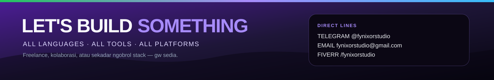

<div align="center">


<a href="https://git.io/typing-svg">
  
</a>

<br/>

<a href="https://github.com/FynixorStudio"></a>
<a href="https://t.me/fynixorstudio"></a>
<a href="mailto:fynixorstudio@gmail.com"></a>
<a href="https://www.fiverr.com/fynixorstudio"></a>
<a href="https://instagram.com/fynixorstudio"></a>

<br/><br/>

**Navigasi**

[](#about)
[](#capabilities)
[](#stack)
[](#work)
[](#stats)
[](#contact)

</div>

---

<a id="about"></a>

## 🧠 About

<div align="center">


</div>

Gw **Fynixor Studio** — studio digital satu orang asal Indonesia, jalan sejak 2023. Gw ngerjain semuanya: website, mobile, desktop, bot, automation, backend, UI, sampai tooling aneh-aneh sekalipun. Kalau bahasa atau tool-nya belum gw pakai, gw bisa pelajari dan langsung pakai. Intinya: **gw bisa semua bahasa, semua tools, semua jenis project**.

```txt
const studio = {
  name: "Fynixor Studio",
  mode: "one person · full stack · no gatekeeping",
  location: "Indonesia",
  since: 2023,
  superpower: "all languages, all tools, all platforms",
  current: ["mcpfs", "Lumina Worksite", "Vorhex Store"],
  philosophy: "paham dulu, baru pilih stack — bukan sebaliknya"
}
```

| 🛒 Vorhex Store | 💼 Lumina Worksite | 🎨 VTuber Agency | 🛡️ MBD |
| :---: | :---: | :---: | :---: |
| Produk digital | Jasa & custom system | Talent & content | Security research |
|  |  |  |  |

---

<a id="capabilities"></a>

## 🧰 Capabilities

<div align="center">


<br/><br/>

**Bahasa → Framework → Database → Cloud → Tools → Desain.** Semua masuk, semua rapi, semua siap dipakai.

</div>

---

<a id="stack"></a>

## ⚡ Stack Highlights

<div align="center">

**💻 Languages**


<br/><br/>

**🧩 Web & Framework**


<br/><br/>

**🗄️ Data & Cloud**


<br/><br/>

**🛠️ Tools & Platform**


</div>

---

<a id="work"></a>

## 📦 Featured Work

<div align="center">

<table>
  <tr>
    <td align="center"><a href="https://github.com/FynixorStudio/mcpfs"></a></td>
    <td align="center"><a href="https://github.com/FynixorStudio/yokotofs-telegram-control"></a></td>
  </tr>
</table>

</div>

- **mcpfs** — local-first MCP config manager. Satu perintah untuk sync & distribute konfigurasi MCP server ke Claude Code, Cursor, OpenCode, Codex CLI, Claude Desktop, dan agen lain. `[Go]`
- **yokotofs-telegram-control** — bot control Telegram buat ngatur alur kerja dari chat. `[PHP]`
- **Anoterra** — kontribusi ke desktop IDE Python bareng [@arraynothere](https://github.com/arraynothere). `[Python]`

<div align="center">


<br/><br/>

**Alur kerja:**

 →  →  →  → 

</div>

<details><summary><b>Bisa semua bahasa & tools?</b></summary><br/>Iya. Kalau belum pernah dipakai, gw pelajari dulu lalu pakai dengan benar. Lihat papan kapabilitas di atas — 72 item, 6 kategori.</details>

<details><summary><b>Terima freelance / commission?</b></summary><br/>Iya. Chat aja scope-nya, nanti gw kasih estimasi dan milestone dari awal.</details>

<details><summary><b>MBD itu apa?</b></summary><br/>Riset & tooling keamanan. Pengujian hanya di sistem sendiri atau yang berizin tertulis.</details>

---

<a id="stats"></a>

## 📊 GitHub Stats

<div align="center">

<table>
  <tr>
    <td align="center"></td>
    <td align="center"></td>
  </tr>
</table>


<br/><br/>

**🐾 Neko Visitor Counter**

<a href="https://count.getloli.com/@FynixorStudio-profile?theme=cat">
  
</a>


</div>

---

<a id="contact"></a>

## 📬 Contact

<div align="center">

<a href="https://t.me/fynixorstudio"></a>
<a href="mailto:fynixorstudio@gmail.com"></a>
<a href="https://www.fiverr.com/fynixorstudio"></a>
<a href="https://instagram.com/fynixorstudio"></a>
<a href="https://github.com/FynixorStudio"></a>

<br/><br/>



<br/>

<sub>© 2026 Fynixor Studio · All languages · All tools · All platforms · Built from scratch</sub>

</div>
