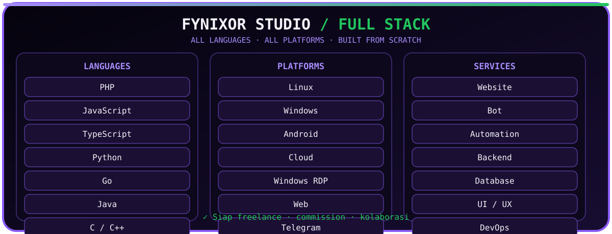

# Fynixor Studio

 

  

---

**Navigasi**

 

---

## 🧩 Overview

**Fynixor Studio** — studio digital satu orang, berbasis di Indonesia, sejak 2023. Produk sendiri lewat **Vorhex Store**, jasa lewat **Lumina Worksite**, eksperimen lewat **VTuber Agency** dan **MBD**.

| 🛒 Vorhex Store | 💼 Lumina Worksite | 🎨 VTuber Agency | 🛡️ MBD |
| :---: | :---: | :---: | :---: |
| Produk digital | Jasa & custom system | Talent & content | Security research |
|  |  |  |  |

---

## 🚀 Kemampuan

**Bisa semua bahasa pemrograman. Bisa semua tools. Bisa semua jenis project.**

### 🗂️ Papan Kapabilitas

### 🧩 Icon Stack

**💻 Bahasa Pemrograman**

  

**🧪 Scripting & Lainnya**

  

**🧩 Framework & Library**

  

**🗄️ Database & Data**

  

**☁️ DevOps, Cloud & Platform**

  

**🎨 Desain & Komunikasi**

  

**⌨️ Editor & Terminal**

### 🏷️ Tool & Language Badges

**💻 Bahasa**

  

**🧩 Framework & Library**

  

**🗄️ Data, Cloud & Tools**

### 📋 Cakupan Kemampuan

| Kategori | Detail | Status |
| :--- | :--- | :---: |
| 🌐 Website & Web App | Landing page, dashboard, frontend, backend, full-stack | ✅ |
| 📱 Mobile | Android, cross-platform, integrasi API | ✅ |
| 💻 Desktop | Aplikasi desktop, tooling, script lokal | ✅ |
| 🤖 Bot | Telegram & WhatsApp, bot control, automation chat | ✅ |
| ⚙️ Script & Automation | Cron, workflow, integrasi antar layanan | ✅ |
| 🗄️ Backend & API | REST API, autentikasi, database, Firebase | ✅ |
| 🎨 UI/UX & Aset | Desain antarmuka, SVG, banner, logo | ✅ |
| ☁️ Cloud & DevOps | Cloud, RDP, Docker, Kubernetes, CI/CD | ✅ |
| 🔐 Security | Riset & tooling (sistem sendiri/berizin) | ✅ |
| 📊 Data & AI | Pipeline data, integrasi API AI | ✅ |
| 🧪 Testing | Unit test, smoke test, QA | ✅ |
| 🔌 Integrasi | Payment, third-party API, webhook | ✅ |
| 🔧 Maintenance | Refactoring, perbaikan, lanjutan | ✅ |
| 💬 Konsultasi | Arsitektur, estimasi, diskusi teknis | ✅ |

---

## 📦 Projects

### ⭐ Featured: mcpfs

Local-first MCP config manager — satu perintah untuk sync & distribute konfigurasi MCP server ke Claude Code, Cursor, OpenCode, Codex CLI, Claude Desktop, dan agen lain.

| Project | Deskripsi | Tech | Status |
| :--- | :--- | :--- | :--- |
| [mcpfs](https://github.com/FynixorStudio/mcpfs) | Sync & distribute MCP servers ke banyak agen | Go |  |
| [yokotofs-telegram-control](https://github.com/FynixorStudio/yokotofs-telegram-control) | Bot control Telegram | PHP |  |
| [FynixorStudio](https://github.com/FynixorStudio/FynixorStudio) | Profil & dokumentasi studio | Markdown |  |
| [Anoterra](https://github.com/arraynothere/Anoterra) | Kontribusi IDE desktop Python | Python |  |

---

## 🛠️ Services

| Layanan | Detail | Status |
| :--- | :--- | :---: |
| 🌐 Website | Landing page → web app + UI | ✅ |
| 🤖 Bot | Telegram & WhatsApp | ✅ |
| ⚙️ Script & Automation | Otomasi alur kerja | ✅ |
| 🗄️ Backend | API, database, Firebase | ✅ |
| 🎨 UI/UX | Desain & aset visual | ✅ |
| 🛠️ Maintenance | Perawatan & lanjutan | ✅ |

**Alur kerja:**

 →  →  →  → 

---

## 🎯 Focus & Status

| Area | Status |
| :--- | :---: |
| Freelance & commission |  |
| Kolaborasi open-source |  |
| Vorhex Store |  |
| Lumina Worksite |  |
| mcpfs & bot control |  |
| VTuber Agency |  |
| MBD |  |
| Finansial / trading |  |

---

## ⚙️ Tech Stack

| Kategori | Stack |
| :--- | :--- |
| Bahasa | PHP · JavaScript · TypeScript · Python · Go · Java · C/C++ · C# · Rust · Ruby · Swift · Kotlin · Scala · Dart · SQL · HTML/CSS |
| Frontend | HTML · CSS · React · Vue · Angular · Next.js · Tailwind · Bootstrap · Svelte |
| Backend | Node.js · Express · Laravel · Django · Flask · FastAPI · Spring Boot |
| Database | MySQL · PostgreSQL · MongoDB · Redis · Firebase · SQLite |
| DevOps | Git · GitHub Actions · Docker · Kubernetes · Terraform · Vercel · Netlify · Cloudflare |
| Platform | Linux · Windows · Android · AWS · GCP · Azure · Cloud |

---

## 📈 Stats

 

 

 

---

## 🗺️ Roadmap

| # | Item | Status |
| :---: | :--- | :---: |
| 1 | Vorhex Store — produk digital |  |
| 2 | Lumina Worksite — bot & automation |  |
| 3 | mcpfs — tooling MCP |  |
| 4 | VTuber Agency |  |
| 5 | MBD — security tooling |  |
| 6 | Finansial / trading |  |

---

## ❓ FAQ

<b>Fynixor Studio itu perusahaan?</b>
 Bukan berbadan hukum — ini wadah untuk produk dan layanan yang gue kerjain sendiri.

<b>Terima kerjaan dari luar?</b>
 Terima lewat Lumina Worksite: website, bot, script, automation, backend, integrasi API. Via Fiverr, Telegram, atau email.

<b>Bisa bahasa & tools apa saja?</b>
 Semua yang dibutuhkan project — lihat papan kapabilitas di atas: 18 bahasa, 18 framework, 18 data/cloud tool, 18 layanan.

<b>MBD itu apa?</b>
 Riset & tools keamanan. Pengujian hanya di sistem sendiri atau yang berizin tertulis.

<b>Project open-source mana?</b>
 <a href="https://github.com/FynixorStudio/mcpfs">mcpfs</a> dan <a href="https://github.com/FynixorStudio/yokotofs-telegram-control">yokotofs-telegram-control</a>.

<b>Berapa lama pengerjaan?</b>
 Tergantung scope. Estimasi & milestone dibahas di awal.

---

## 🎨 Brand Assets

| Aset | Preview | Fungsi |
| :--- | :---: | :--- |
| <a href="https://github.com/FynixorStudio/FynixorStudio/blob/main/logo.svg">logo.svg</a> |  | Monogram utama |
| <a href="https://github.com/FynixorStudio/FynixorStudio/blob/main/capabilities.svg">capabilities.svg</a> |  | Papan 72 kapabilitas, 4 kolom rapi |
| <a href="https://github.com/FynixorStudio/FynixorStudio/blob/main/hero.svg">hero.svg</a> |  | Banner pembuka |
| <a href="https://github.com/FynixorStudio/FynixorStudio/blob/main/header.svg">header.svg</a> |  | Banner kontak |
| <a href="https://github.com/FynixorStudio/FynixorStudio/blob/main/skills.svg">skills.svg</a> |  | Visual stack |
| <a href="https://github.com/FynixorStudio/FynixorStudio/blob/main/telegram.svg">telegram.svg</a> |  | Ikon Telegram |
| <a href="https://github.com/FynixorStudio/FynixorStudio/blob/main/instagram.svg">instagram.svg</a> |  | Ikon Instagram |

<pre>
FynixorStudio/
├── logo.svg          # monogram
├── capabilities.svg  # 72 kapabilitas, 4 kolom
├── hero.svg          # banner pembuka
├── header.svg        # banner penutup
├── skills.svg        # visual stack
├── telegram.svg      # ikon kontak
├── instagram.svg     # ikon kontak
├── build_assets.py   # generator aset
└── README.md         # dokumentasi profil
</pre>

---

## 🤝 Credits

| Role | Badge |
| :--- | :--- |
| Owner |  |
| Referensi |  |
| Kontribusi |  |

---

## 📄 License

---

## 📬 Contact

  

 

 

 

© 2026 Fynixor Studio · Built from scratch, whatever the stack.

