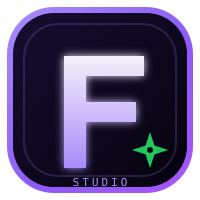

# Fynixor Studio

 

  

 

---

---

## 

**Fynixor Studio** — studio digital satu orang, berbasis di Indonesia, sejak 2023. Gue bangun produk sendiri lewat **Vorhex Store**, terima kerjaan lewat **Lumina Worksite**, dan terus eksperimen lewat **VTuber Agency** dan **MBD**.

| 🛒 Vorhex Store | 💼 Lumina Worksite | 🎨 VTuber Agency | 🛡️ MBD |
| :---: | :---: | :---: | :---: |
| Produk digital | Jasa & custom system | Talent & content | Security research |
|  |  |  |  |

---

## 

### Bisa semua bahasa pemrograman. Bisa semua jenis project.

  

  

  

### Apa saja yang bisa dikerjakan

| Kategori | Kemampuan | Status |
| :--- | :--- | :---: |
| 🌐 **Web** | Landing page, web app, dashboard, UI/UX, frontend & backend | ✅ |
| 📱 **Mobile** | Android, cross-platform, integrasi API | ✅ |
| 💻 **Desktop** | Aplikasi desktop, tooling, script lokal | ✅ |
| 🤖 **Bot** | Telegram & WhatsApp, bot control, automation chat | ✅ |
| ⚙️ **Automation** | Script, workflow, cron, integrasi antar layanan | ✅ |
| 🗄️ **Backend** | REST API, database, Firebase, autentikasi | ✅ |
| 🎨 **UI/UX** | Desain antarmuka, SVG, aset visual, prototype | ✅ |
| ☁️ **Cloud & DevOps** | Cloud, RDP, Docker, CI/CD, deployment | ✅ |
| 🔐 **Security** | Riset & tooling keamanan (sistem sendiri/berizin) | ✅ |
| 📊 **Data & AI** | Integrasi data, API AI, pipeline sederhana | ✅ |
| 🔧 **Maintenance** | Perbaikan, refactoring, pengembangan lanjutan | ✅ |
| 💬 **Konsultasi** | Diskusi teknis, arsitektur, estimasi | ✅ |

---

## 

### ⭐ Featured: mcpfs

Local-first MCP config manager — satu perintah untuk sync & distribute konfigurasi MCP server ke Claude Code, Cursor, OpenCode, Codex CLI, Claude Desktop, dan agen lain.

| Project | Deskripsi | Tech | Status |
| :--- | :--- | :--- | :--- |
| [mcpfs](https://github.com/FynixorStudio/mcpfs) | Sync & distribute MCP servers ke banyak agen | Go |  |
| [yokotofs-telegram-control](https://github.com/FynixorStudio/yokotofs-telegram-control) | Bot control Telegram | PHP |  |
| [FynixorStudio](https://github.com/FynixorStudio/FynixorStudio) | Profil & dokumentasi studio | Markdown |  |
| [Anoterra](https://github.com/arraynothere/Anoterra) | Kontribusi IDE desktop Python | Python |  |

---

## 

| Layanan | Detail | Status |
| :--- | :--- | :---: |
| 🌐 Website | Landing page → web app + UI | ✅ |
| 🤖 Bot | Telegram & WhatsApp | ✅ |
| ⚙️ Script & Automation | Otomasi alur kerja | ✅ |
| 🗄️ Backend | API, database, Firebase | ✅ |
| 🎨 UI/UX | Desain & aset visual | ✅ |
| 🛠️ Maintenance | Perawatan & lanjutan | ✅ |

**Alur kerja:**

 →  →  →  → 

---

## 

| Area | Status |
| :--- | :---: |
| Freelance & commission |  |
| Kolaborasi open-source |  |
| Vorhex Store |  |
| Lumina Worksite |  |
| mcpfs & bot control |  |
| VTuber Agency |  |
| MBD |  |
| Finansial / trading |  |

---

## 

| Kategori | Stack |
| :--- | :--- |
| Bahasa | PHP · JavaScript · TypeScript · Python · Go · Java · C/C++ · C# · Rust · Ruby · Swift · Kotlin · SQL |
| Frontend | HTML · CSS · React · Vue · Angular · Next.js |
| Backend | Node.js · Express · Laravel · Django · Flask · FastAPI · Spring Boot |
| Database | MySQL · PostgreSQL · MongoDB · Redis · Firebase · SQLite |
| DevOps | Git · GitHub Actions · Docker · Kubernetes · Vercel · Netlify · Cloudflare |
| Platform | Linux · Windows · Android · AWS · GCP · Azure · Cloud |

---

## 

 

 

 

---

## 

| # | Item | Status |
| :---: | :--- | :---: |
| 1 | Vorhex Store — produk digital |  |
| 2 | Lumina Worksite — bot & automation |  |
| 3 | mcpfs — tooling MCP |  |
| 4 | VTuber Agency |  |
| 5 | MBD — security tooling |  |
| 6 | Finansial / trading |  |

---

## 

<b>Fynixor Studio itu perusahaan?</b>
 Bukan berbadan hukum — ini wadah untuk produk dan layanan yang gue kerjain sendiri.

<b>Terima kerjaan dari luar?</b>
 Terima lewat Lumina Worksite: website, bot, script, automation, backend, integrasi API. Via Fiverr, Telegram, atau email.

<b>Bisa bahasa apa saja?</b>
 Semua yang dibutuhkan project: PHP, JavaScript/TypeScript, Python, Go, Java, C/C++, C#, Rust, Ruby, Swift, Kotlin, SQL, HTML/CSS, dan lain-lain.

<b>MBD itu apa?</b>
 Riset & tools keamanan. Pengujian hanya di sistem sendiri atau yang berizin tertulis.

<b>Project open-source mana?</b>
 <a href="https://github.com/FynixorStudio/mcpfs">mcpfs</a> dan <a href="https://github.com/FynixorStudio/yokotofs-telegram-control">yokotofs-telegram-control</a>.

<b>Berapa lama pengerjaan?</b>
 Tergantung scope. Estimasi & milestone dibahas di awal.

---

## 

| Aset | Preview | Fungsi |
| :--- | :---: | :--- |
| <a href="https://github.com/FynixorStudio/FynixorStudio/blob/main/logo.svg">logo.svg</a> |  | Monogram utama |
| <a href="https://github.com/FynixorStudio/FynixorStudio/blob/main/capabilities.svg">capabilities.svg</a> |  | Papan kapabilitas |
| <a href="https://github.com/FynixorStudio/FynixorStudio/blob/main/hero.svg">hero.svg</a> |  | Banner pembuka |
| <a href="https://github.com/FynixorStudio/FynixorStudio/blob/main/header.svg">header.svg</a> |  | Banner kontak |
| <a href="https://github.com/FynixorStudio/FynixorStudio/blob/main/skills.svg">skills.svg</a> |  | Visual stack |
| <a href="https://github.com/FynixorStudio/FynixorStudio/blob/main/telegram.svg">telegram.svg</a> |  | Ikon Telegram |
| <a href="https://github.com/FynixorStudio/FynixorStudio/blob/main/instagram.svg">instagram.svg</a> |  | Ikon Instagram |

<pre>
FynixorStudio/
├── logo.svg          # monogram
├── capabilities.svg  # papan kemampuan
├── hero.svg          # banner pembuka
├── header.svg        # banner penutup
├── skills.svg        # visual stack
├── telegram.svg      # ikon kontak
├── instagram.svg     # ikon kontak
├── build_assets.py   # generator aset
└── README.md         # dokumentasi profil
</pre>

---

## 

| Role | Badge |
| :--- | :--- |
| Owner |  |
| Referensi |  |
| Kontribusi |  |

---

## 

---

## 

  

 

 

 

© 2026 Fynixor Studio · All languages. All platforms. Built from scratch.

